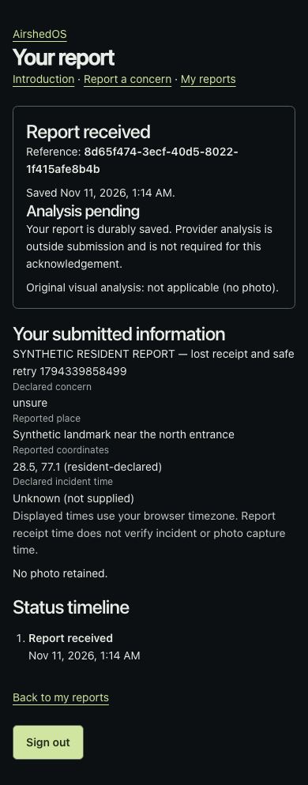

# Phase 3 — Resident interface

Date: 10 November 2026 (Asia/Calcutta). Contract: `seva_pilot_v1`.
Status: **COMPLETE_LOCALLY_VERIFIED; external/live gates pending**.
Implementation is local; no claim that this code is deployed.

## Checkout and boundary

Selected checkout: `<authorised AirshedOS checkout>`.
Actual HEAD remains `6f071afd10f0ffed024448ac87d3bfae9ec8abc4` on
`codex/seva-phase-3`. The branch preserves the uncommitted Phase 0–2 implementation
and unrelated untracked presentation/output artifacts. No checkout was reset,
secret file copied, remote pushed or live database migrated. This report describes
the working tree, not a new committed revision.

Phase 3 consumes the actual Phase 1 repository/media/retention seams and Phase 2
managed identity, BFF, owner scope and shared admission controls. It implements the
resident journey. Phase 4 reviewer workflow, Phase 5 durable processing and Phase 7
visual polish remain outside scope. No process-local background task substitutes
for a worker. Initial processing jobs remain pending.

The blueprint's `/resident` redirect is adapted to an authenticated introduction,
as explicitly required by this phase. The existing colors/components are retained
with restrained forms and narrow-screen layouts. The legacy prototype remains
separate; explicit pilot mode continues to block v1 operations.

## What residents can do

| Route | Implemented behavior |
|---|---|
| `/sign-in` | Existing managed Auth0 SDK login, safe return destinations and honest unavailable/error states |
| `/resident` | Introduction, retention notice and links to new/own reports |
| `/resident/reports/new` | Description, concern category, reported place/approximate coordinates, optional declared incident time, optional consented photo and optional local context |
| `/resident/reports` | Authenticated, paginated own-report summaries |
| `/resident/reports/[reportId]` | Durable receipt, original declared facts, private photo, deliberate published status timeline and information-request replies |

Manual coordinates and a place label work without device permission or Maps.
Geolocation requires a deliberate button press, uses approximate device settings
and never marks a location verified. Opening the map sets no report coordinate
until the resident chooses a point. A map/GPS failure preserves manual entry.
Blank incident time is persisted as `NULL`/`unknown`, rather than receipt time or
EXIF. Supplied time is labelled resident-declared and converted from device local
time to an aware API timestamp. Browser display timezone is disclosed.

Text-only reporting is valid. Visual processing is explicitly `NOT_APPLICABLE`
without a photo; the interface creates no interpretation and makes no inference
that missing imagery clears or disproves a report. Receipt and analysis are
separate: the current honest state is **Analysis pending**.

Semantic labels/fieldsets, native validation, visible keyboard focus, focused
error messages, disabled in-flight controls, 44px buttons and one-column mobile
fields provide functional accessibility. Loading, unavailable, unknown-outcome,
expired-photo and retry states are explicit. This is not an accessibility
certification or the final visual design.

## Acceptance and safe retries

`POST /api/v2/resident/reports` projects `ResidentReceipt` only after the
repository transaction commits. It atomically creates the report, one case,
initial reporter update, processing attempts, pending job and idempotency record.
It calls no AI or environmental provider. A transaction failure returns no saved
reference; provider availability cannot lose an accepted report.

The browser generates one UUID key and aware creation timestamp per attempted
report. Both are forwarded through the CSRF-protected allowlisted BFF. The
existing owner/operation/key lock and request fingerprint make a same-input replay
return the original IDs; changed accepted input conflicts. An authenticated
`GET /api/v2/resident/submissions/{key}` checks the owner's committed receipt under
the same lock, allowing a response lost after commit to be recovered without
another report. This is not possession-based receipt authentication.

In-page retries freeze the attempted DTO after admission. The tab keeps only the
owner-scoped retry reference by default. A separate explicit checkbox permits
attempted text/coordinates to be kept in `sessionStorage` for at most 24 hours;
receipt, logout or account change clears it. Photos and login tokens are never
stored in this draft. Reload performs only an authenticated receipt lookup;
it does not automatically submit. Unkept text must be re-entered if no commit
exists. Back navigation cannot resubmit an HTML POST. Double-clicks are fenced
in the client and independently by the database contract.

## Images and private storage

`POST /api/v2/resident/media` accepts one JPEG/PNG plus explicit
`retention_consent=true`. The whole multipart request is bounded before parsing;
the source image limit is 4,000,000 bytes and 16 MP. Decode/re-encode strips EXIF,
GPS and PNG metadata, applies orientation, limits dimensions to 2048px and writes
only a cleaned JPEG derivative. Original uploads/filenames are not retained in
the database or object store; request parsing may use temporary upload buffers,
which are closed after the request. A damaged PNG checksum now produces a safe
422 instead of an unhandled decoder exception, with regression coverage.

Staging uses the existing durable WRITING/READY intent, compensation and orphan
reconciliation. Unattached media expire within one hour. Attached images expire
at the earlier of 30 days from staging or parent report expiry; supplementary
images follow the same rule. The report/supplement transaction consumes only an
owned, ready, unexpired stage. Declining consent, storage outage or rejected image
still allows text acceptance through an explicit send-without-photo action.

The hosted adapter uses maintained **boto3 1.43.127 / botocore 1.43.127** and private
Cloudflare R2's S3 API. It is inactive unless `MEDIA_BACKEND=s3` and
`PRIVATE_MEDIA_APPROVED=1`, with an exact R2 HTTPS endpoint, explicit server-only
credentials and bucket configuration. Missing/malformed optional storage settings
leave text intake available. There is no production local-disk fallback.

Random object keys live under `seva-private/derivatives/`, with conditional writes,
bounded reads, timeouts/retries and `private, no-store`. No public URL, ACL,
original metadata or browser presigned link is issued. Bytes are served through
the independently authorized media API/BFF; native images bypass the shared Next
image optimizer. Both original and supplemental media reads verify owner or
assigned-unit scope, parent access suppression and expiry. Browser expiry timers
also handle 30-day durations without overflowing the browser timer limit.

The adapter's mocked SDK contract is verified locally; real R2 upload/read/delete,
bucket privacy, permissions and lifecycle behavior are **pending**. The approval
flag cannot itself certify bucket privacy. Before real collection, disable public
bucket access, restrict credentials to the dedicated prefix and verify deletion.
`python -m app.resident.maintenance` provides one-shot retention/reconciliation with
separate cleanup credentials. No hosted scheduler was installed: schedule it at
least every minute and verify operations/backups before enabling collection.
API expiry hides content immediately even if physical deletion needs retry.

Primary integration references reviewed for this addition:
[R2 boto3 usage](https://developers.cloudflare.com/r2/examples/aws/boto3/),
[R2 S3 compatibility](https://developers.cloudflare.com/r2/api/s3/api/),
[boto3 S3 client](https://boto3.amazonaws.com/v1/documentation/api/latest/reference/services/s3.html),
[botocore configuration](https://botocore.amazonaws.com/v1/documentation/api/latest/reference/config.html),
[Vercel function request limits](https://vercel.com/docs/functions/limitations).
The 4 MB upload budget leaves room below the hosting request limit; hosted behavior
still requires rehearsal. No unrelated dependency upgrade or cloud provisioning.

## Append-only replies and privacy

Migration `seva_0003` adds the reported place label, `information_requests`,
`report_supplements`, idempotent reply result IDs and a single-parent media link.
The current domain has 26 tables. Database triggers prevent supplement edits and
request reopening, allowing explicit content-null retention/deletion exceptions.

The internal scoped reviewer seam publishes a deliberate prompt/reporter update
and review event with an expected revision. It has no new public Phase 3 reviewer
action or dashboard. The browser fixture invokes it through explicitly local test
tooling; Phase 4 must supply the authorized reviewer workflow.

`POST .../reports/{report_id}/information-requests/{request_id}/replies` checks the
owner, parent case, open request, expiry and shared reply limit in a transaction.
It appends one text/optional image supplement per request, advances the case audit
revision and records an idempotent receipt. Reload shows the accepted reply, and
duplicate/new-key attempts cannot overwrite it. Original report facts and frozen
evidence are unchanged. Another reviewer request permits another separate reply.
The response models omit private notes, staff identifiers, object keys, owner/unit
fields and provider internals. Timeline entries contain only explicit published
updates and the resident's own supplements. No email or external notification.

Report retention/deletion also clears supplementary text, prompts, associated
image bytes and request fingerprints; terminal tombstone cleanup respects foreign
keys. Hashes do not stand in for deletion. Revocation, active sessions, ownership,
non-disclosing 404s, CSRF and private no-store responses remain backend enforced.
The existing scoped withdrawal/privacy APIs remain; this phase adds no full
resident privacy-management interface.

## Optional local context

Local AQ/weather requires a separate explicit request. Source/observation/retrieval
time and attribution accompany available readings; unavailable providers show an
honest message. Changed coordinates hide previous-place readings. Neither context,
Maps nor GPS participates in acceptance. No fire/satellite/forecast query or extra
corroboration vote is introduced, and nothing is copied into evidence or a job.

Pilot cache retention is capped at 15 minutes. The browser expires readings using
their original retrieval deadlines. User context admission defaults to 6/hour,
supplement replies to 20/day; existing intake/staging/global paid-admission limits
remain PostgreSQL-backed. Configured context providers reserve shared budget before
fetch; conservative reservation may charge a cache hit. These are configurable
pilot limits, not measured capacity. Spoofable IP headers do not determine identity.
Actual Google availability and policy approval were not rehearsed in this phase.

## Local evidence and reproduction

Use the guarded disposable PostgreSQL target from [development](../DEVELOPMENT.md).
Run database-resetting backend fixtures before the identity/browser harnesses.

| Check | Result |
|---|---|
| `.venv/bin/python -m pytest -q` with explicit `TEST_DATABASE_URL` | **598 passed**, 2 existing dependency deprecation warnings, 35.96s; no skipped PostgreSQL gate |
| Ruff check and format | PASS, 124 files |
| Migration to `seva_0003`, `alembic check` | PASS, no model drift; restricted-role permission regressions retained |
| `npm run test:identity` with local PG | **5 passed**, zero skips; existing signed SDK/session/BFF/API/logout checks |
| `npm run test:resident` with local PG | **4 passed**, 17.3s, 390×844 Chromium |
| Frontend lint, typecheck and production build | PASS, Next.js 16.4.6 |
| OpenAPI exporter then `npm run generate:api` | PASS; new v2 contracts generated, receiver/scientific records preserved |
| Existing production-build browser regression suite | **62 passed**, 1.2 minutes; all existing journeys retained |
| Secret scan including build artifacts | PASS, 2,888 files, zero findings |
| Protected records/contracts | All 11 protected records and four baseline contract/scientific hashes match |
| Whitespace and phase-document local links | PASS |

The resident browser harness uses actual SDK code/state/nonce/PKCE login, signed
tokens, sealed database sessions, BFF and FastAPI over real local HTTP/TLS/PG.
Two synthetic residents are separate browser contexts. A synthetic HTTPS OIDC host
is mapped to loopback by a test-process fetch preload and Chromium resolver rule;
Python's normal bounded JWKS loader uses the local HTTPS transport while still
checking the configured issuer and signatures. Ephemeral CA certificates satisfy
strict Python TLS verification; browser certificate tolerance is fixture-only.
No application environment flag selects this transport or enables fake login.
Test helpers are not included in the API image. Real Auth0 credentials are absent.

Evidence includes a committed response deliberately lost on the network followed
by retry and SQL count=1; a failed save with count=0 and no false acknowledgement;
reload/list/history; `NULL` unknown incident time; no AI dependency; declined image;
GPS/Maps/context failures; keyboard submission; private derivative display; published
information request and reply; original content preserved; internal-note absence;
and resident B's 404 for resident A's report/media. Additional PostgreSQL API tests
exercise rollback, changed-payload conflicts, spoofing, consent, body limits,
corrupt PNG rejection, append-only constraints, evidence immutability and purge.
CI now runs the controlled resident browser journey after backend/identity checks.
No remote CI execution is claimed.

This screenshot is a local development capture of a synthetic record, not evidence
of a production deployment, real resident or AI result.

## Remaining gates and next dependency

Managed live sign-in/refresh/back-channel rehearsal, private R2 verification,
hosted roles/migration/cleanup/backup policy, approved privacy/terms and separate
deployment authorization remain pending. Existing dependency advisories recorded
in Phase 2 remain release-hardening work; no zero-vulnerability claim is made.
The local tests prove deterministic application boundaries, not production
capacity, scientific accuracy, government participation or measured user benefit.

Next is Phase 4's authorized reviewer workflow over the shared case domain,
including deliberate information requests/updates and the supplied later-phase
contract. A durable analysis worker is still reserved for Phase 5. No training,
historical final evaluation, automatic processing, notifications, official delivery
or brand redesign was started. `MODEL_NOT_ACCEPTED` is preserved.
