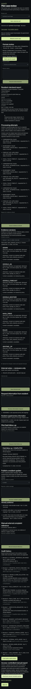

# Phase 4 — Authority dashboard

Date: 10 November 2026 (Asia/Calcutta). Contract: `seva_pilot_v1`.
Status: **COMPLETE_LOCALLY_VERIFIED; external/live gates pending**. This is local code, not a deployment.

## Source and scope

Selected checkout: `/Users/aadityajain/Technical Assessments/Onboarding/Google Build Week`.
Actual HEAD remains `6f071afd10f0ffed024448ac87d3bfae9ec8abc4` on
`codex/seva-phase-4`. All Phase 0–4 work remains uncommitted, preserving unrelated
presentation/output artifacts. The requested pause was honored and implementation
resumed only after the user's instruction. No reset, other-checkout edit, secret
copy, push, deployment, hosted migration, paid provisioning or message occurred.

This phase consumes the actual preceding identity, repository, media, revision and
resident-reply seams. It completes the human review interface and explicit bounded
manual enrichment. No worker, automatic legal decision, government transport,
automatic closure, custom-model research or final visual redesign is introduced.

## Functional route spaces

| Route | Behavior |
|---|---|
| `/authority` | Approved-unit pilot introduction and queue entry |
| `/authority/cases?unit=...` | Scoped description/state/ownership filters, totals, 20-item pages and optional equivalent map |
| `/authority/cases/[caseId]?unit=...` | Report, review, assignment, processing attempts, source/evidence versions, notes, requests/replies, follow-up, publication, audit and export |
| `/authority/unit?unit=...` | Own-unit administrator proposals, membership state and reviewer suspension |

The server selects only a unit returned by the verified account's current membership.
FastAPI independently rechecks scope for every request and mutation. Search, counts,
filters and pagination operate on permitted SQL rows; the browser never fetches a
global queue for client-side access filtering. Pagination is bounded to 50/API page
and offset 1000; the UI uses 20. The optional map displays the same filtered page,
and its equivalent links/list remain available after Maps failure. Coordinates are
resident declarations, not routing authority. Prototype rectangle lookup grants
nothing and dispatches nothing. Unit membership is explicitly labelled pilot access,
not evidence of a government partnership.

The restrained interface reuses existing shells, styles, Maps loader and semantic
controls. Labels, keyboard focus, narrow layouts, pending/error/expiry states and
conflict recovery are functional. Comprehensive polish remains Phase 7.

## Review, ownership and concurrency

The historical stored state values retain their meanings:

| State | Meaning and allowed next action |
|---|---|
| `NEW` | Awaiting a human reviewer; may start `UNDER_REVIEW` |
| `UNDER_REVIEW` | May acknowledge internally, monitor or close with a reason |
| `ACKNOWLEDGED` | Internal acknowledgment; may monitor or close; no verification/dispatch claim |
| `MONITORING` | May return to review, acknowledge or close |
| `CLOSED_NO_ACTION` | Review ended; explicit reasoned `REOPEN` command returns to `UNDER_REVIEW` |

`REOPEN` is a new explicit command, not an invented stored remediation state.
Closure and reopening require nonblank reasons in the backend. Closure also requires
open field follow-ups to be completed or cancelled. The interface explains that
constraint. Processing and review remain separate: successful AI/provider execution
cannot acknowledge, verify, close, reopen or publish a case automatically.

A reviewer may claim an unassigned/self-owned case. Assigning another active member,
clearing ownership or replacing another owner requires an administrator in that
same unit. Targets come from approved active membership/account rows; a submitted
membership ID is merely a selection, never a grant. Unit transfer/bootstrap remain
operator actions, not coordinate inference or dashboard powers.

Case writes lock the report/case and relevant authoritative grants, check
`expected_revision`, append an audit event and commit together. Competing writes
cannot overwrite silently. Stale review transitions return a conflict before state
validation; task/assignment failures also roll back their whole transaction. The UI
blocks uncertain/stale writes, retains the entered text and requires a deliberate
reload/review before retry. It does not automatically replay a private note or a
publication after an uncertain response.

The audit records action, revision, time, optional task and the evidence version
visible to that action. Private reasons/findings are retained with the parent report
content, then nulled under an explicit purge exception; the minimal audit metadata
can outlive them. Database triggers reject arbitrary history edits. The API role has
no UPDATE privilege on review events; separately approved cleanup performs redaction.

## Notes, publication and the resident round-trip

Internal notes, review reasons, field findings and manual references remain private.
Reporter updates and information requests use separate strict request/response
models and blank public-message fields with a preview and explicit publish action.
There is no automatic copy from notes or a model result into the public timeline.
Only initial `RECEIVED` is generated automatically at acceptance. Publishing `CLOSED`
requires internal closure, but internal closure alone does not publish it.

An information request deliberately publishes a prompt and accepts one append-only
resident reply with optional consented private media. The reviewer sees the reply
and its private image through the case scope. Original report facts and earlier
captured evidence remain unchanged. A later request permits another separate reply.
Closing a case closes outstanding unanswered requests; it does not rewrite prompts
or earlier replies. Private case revision numbers order stored events, but residents
receive only consecutive ordinals for visible updates/replies, without hidden-action
gaps or staff identifiers.

Field follow-up uses `REQUESTED -> ASSIGNED -> COMPLETED`, with cancellation from
requested/assigned. Reviewers can claim their own task; assigning another member is
unit-admin-only. Completion requires its assignee or a unit admin, a finding/reason
and the current case revision. Each action advances task/case history atomically.
A recorded finding is a reviewer statement, not automatic evidence that pollution
was eliminated or that an agency dispatched a team.

A manual external complaint reference is stored as bounded text with an audit event.
It is not a delivery API state, external message or claim of actual government receipt.

## Evidence and explicit manual enrichment

Case detail separates the citizen's declared concern/place/time, private images,
Gemini interpretation, retained source observations, deterministic support, volatile
Google context/outlook and human decision. Omitted incident time stays unknown;
receipt/provider retrieval time does not verify capture time. Source displays retain
observation/retrieval/expiry, units, product/quality metadata and attribution. Both
original normalized v1 fragments and new retained-source v2 shapes remain readable.

Manual enrichment is a CSRF-protected action with a reason and revision. It admits a
single case request through shared PostgreSQL limits, commits a recorded request and
stage attempts, performs provider IO outside database locks with a 45-second outer
deadline, then rechecks session, membership, parent access, withdrawal and admission
before atomic version finalization. Revoked/expired/suppressed or superseded results
are discarded. Old evidence is never silently replaced, and review state is unchanged.

Manual requests have distinct `MANUAL_ENRICHMENT` records and a 90-second admission.
They are request-bound, not restart-safe jobs. Process death can leave interrupted
metadata; after 90 seconds case reads label the attempt `REQUEST_INTERRUPTED` and a
new deliberate request may be admitted. There is no background retry, worker claim,
heartbeat daemon or recovery claim. Future worker polling must exclude this kind.
Initial `PROCESS_REPORT`/durable refresh seams remain pending for Phase 5.

Checks use the original report photo/description/declared coordinates. Supplemental
material stays separate for human review. Without an original usable image, Gemini
is not invoked and visual processing is not applicable. A text-only adapter freezes
`INSUFFICIENT / NO_VISUAL_HYPOTHESIS` with no invented event category, independently
of source availability. A failed visual/provider call records safe stage codes and
an unavailable/partial version; the saved report remains manually reviewable.
Residents now see the latest completed attempt's safe state rather than indefinite
pending after a known failure.

Existing provider/rule adapters and numeric thresholds are reused. Saved evaluation
uses `pilot_retained_sources_v1`: Gemini, bounded FIRMS observations (maximum 500),
permitted Sentinel context and their derived advisory rules. Google current
AQ/weather/forecast are excluded from saved inputs, payloads, hashes and exports;
fragments explicitly say `NOT_RETAINED_BY_POLICY`. Forecast is never an extra
corroboration vote. Support categories remain uncalibrated checklists; absent
observations cannot clear a report, and satellite context cannot prove a local
source or violation. The actual returned Gemini model version is retained when
supplied; unapproved model selection does not silently receive another model's label.

Retained provider content remains **off by default**. Runtime collection requires
`RETAINED_PROVIDER_CONTENT_APPROVED=1` plus a successful cleanup heartbeat within
120 seconds. Cleanup must find no overdue protected report/media/fragment backlog
before renewing health. Schedule the existing one-shot maintenance at least every
minute and verify actual physical deletion/backups before enabling collection.
The flag is not legal certification. Synthetic fixtures inject approval only for
controlled local test data. There was no live provider retention or quota rehearsal.

Rule payload expiry is bounded by the earliest contributing source/image deadline.
Read projections/timers hide expired content immediately; cleanup removes payloads,
protected hashes and dependent copies without recomputing old assessments. Parent
privacy purge clears new reasons, references and supplementary content too.

## Optional context, export and administration

Optional Google AQ/weather and the separate 6/12/24-hour forecast are explicitly
requested, no-store and volatile for at most 15 minutes from original retrieval.
Source/time/attribution and unavailable states are visible; horizon values are window
peaks, not end-of-window readings. Context cannot change saved support or review.
Withdrawal stops new provider work. Paid context operations now use strict-body
**POST**, replacing the Phase 3 resident GET and protecting reviewer context with
CSRF; resident coordinates no longer enter request URLs. Safe login returns permit
only the explicit local authority paths and a validated unit query.

The existing `pilot_case_packet_v1` metadata endpoint remains intact. The new
`/export-v2` returns `pilot_case_packet_v2 / MANUAL_EXPORT`, source/time/policy states,
review/evidence bindings and SHA-256 of the exact canonical `packet` object (sorted
keys, compact JSON, UTF-8). It includes the most recent 100 evidence versions and
500 audit actions, chronologically ordered, with actual totals and a truncation
flag. The latest decision's provenance is retained when older entries are omitted.

Export deliberately omits note/reason bodies, identity/contact, exact report location,
manual reference text, media bytes/URLs/keys, provider payloads and protected input
hashes. Source payload redistribution remains unapproved. This is a bounded metadata
copy, not a full evidentiary packet or agency delivery. Scope/expiry are checked
independently at download. The legacy `pollution_event_v1` schema/receiver and
scientific/protected records remain unchanged; v2 cases are never cast into it.

Administrators can inspect their unit's membership state, propose reviewer membership
for an existing verified issuer/subject and suspend reviewers in their own unit.
Proposals grant nothing and send no message. Only the separately authenticated
operator can approve/reactivate/escalate, create units/admins or transfer units.
Revocation is checked against the current database state, not stale role claims.

## Local evidence

Use the disposable PostgreSQL instructions in [development](../DEVELOPMENT.md).
Database-resetting pytest fixtures and identity/browser harnesses must run sequentially.

| Command/check | Result |
|---|---|
| `TEST_DATABASE_URL=... .venv/bin/python -m pytest -q` | **609 passed**, 2 existing dependency warnings, 38.56s |
| API Ruff check/format | PASS, 131 files |
| `npm run test:authority` | **2 passed**, 33.5s, actual SDK/OIDC/BFF/API/PostgreSQL, narrow 390px review view |
| `npm run test:resident` | **4 passed**, 15.2s |
| `npm run test:identity` | **5 passed**, zero skips |
| Frontend lint/types/production build | PASS, Next.js 16.4.6 standalone build |
| Existing production browser suite | **62 passed**, 1.2 minutes, actual standalone production server |
| OpenAPI then frontend type generator | PASS, new v2 schemas generated; legacy receiver unchanged |
| Migration/drift | PASS, `seva_0004`; no new upgrade operations |
| Secret scan including build artifacts | PASS, **3,122 files**, zero findings |
| Protected records, links and whitespace | All 11 protected records/four baseline hashes match; eight phase documents resolve local links; `git diff --check` PASS |

Eleven new PostgreSQL tests cover the full round-trip, assignment/task permissions,
new-path cross-unit/citizen denial, concurrent/stale revisions, frozen success and
expiry, provider failure, maintenance freshness, in-flight revocation, separate
context, privacy redaction, safe downgrade refusal and bounded export provenance.
The populated `seva_0004 -> seva_0003` downgrade refuses records v3 cannot represent,
with its transaction rolled back and data intact. Guarded disposable fixtures clear
their synthetic data before structural downgrade/reapply; no forced production data
conversion is provided. The current schema has 27 domain tables. The final targeted authority rerun also
passed all 11 tests after ensuring the bounded reply panel keeps recent replies.

The two-sided browser flow submits a resident report, assigns/reviews it, observes a
controlled provider failure, publishes a question, waits for the committed resident
reply, records a pilot follow-up/finding, closes with a reason and separately
publishes the safe resident update. It verifies private-note/finding/reason absence,
a second reviewer's stale-write rejection, map-failure list access, other-unit
read/media/evidence/export denial and an actual downloaded metadata packet. The
admin flow verifies proposal-without-grant and immediate suspension on an existing
session. CI runs the authority harness alongside preceding checks. No remote CI
execution or live tenant/provider success is claimed. Temporary regression servers
and the dedicated synthetic database were cleaned up after verification.

This is a local synthetic capture, not a recruited user, real field visit, government
partnership, production screenshot or scientific accuracy result.

## Remaining gates and next dependency

Live Auth0 sign-in/refresh/back-channel, R2 privacy/read/delete, hosted roles/migrations,
cleanup/deletion-backup/restore rehearsal, source/billing permitted-use review and
approved resident notices remain external release gates. Case-detail panels are bounded snapshots (generally 50 rows, with 200 processing
rows); the full audit history is paginated. More panel-history browsing is a larger
pilot hardening dependency. Exports are explicitly bounded metadata, not full case
content. Existing dependency advisories from Phase 2 remain hardening work. No zero-vulnerability, production
capacity, measured benefit or real agency receipt is claimed.

Next is **Phase 5 — durable automatic processing**, using the actual schema, retained
source policy and version/revision contracts. Implement real leases/retries/recovery
for pending durable jobs; do not treat Phase 4's manual admission as a worker lease
or replay `MANUAL_ENRICHMENT` records. Comprehensive UI polish stays in Phase 7.
